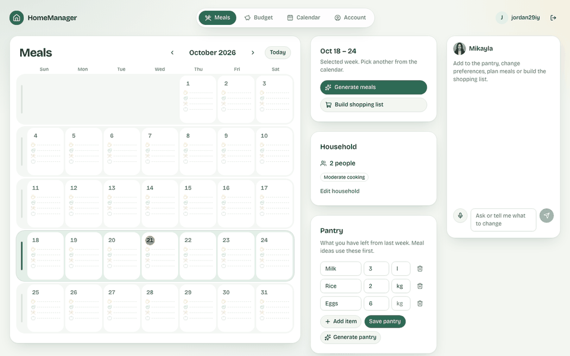
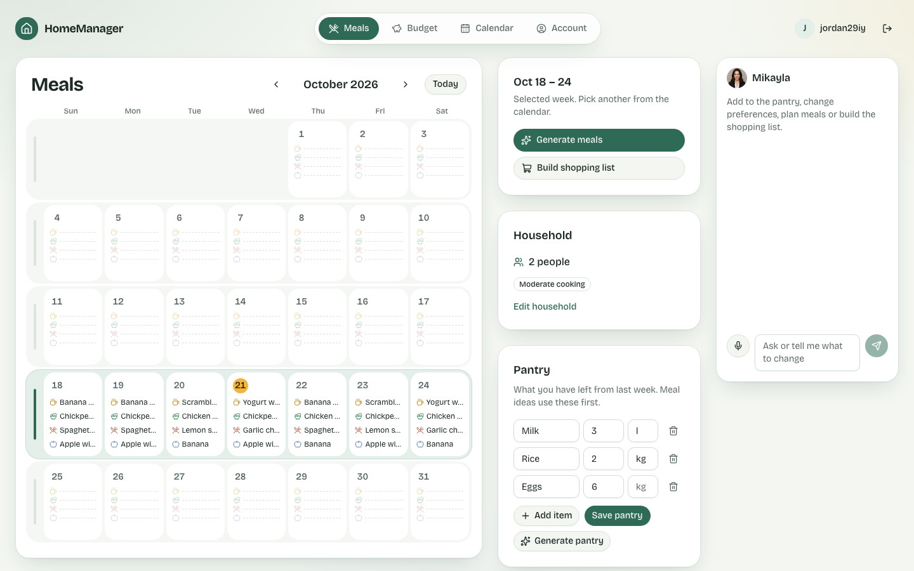
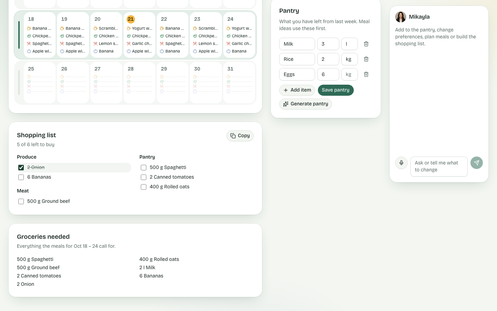
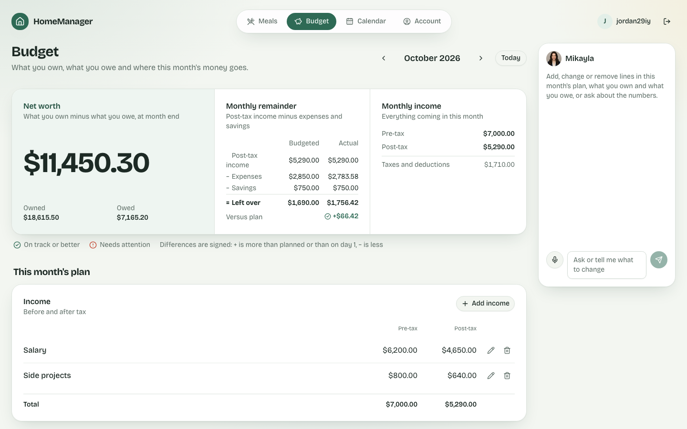
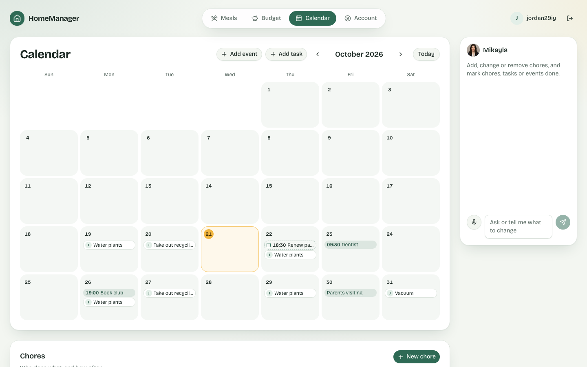
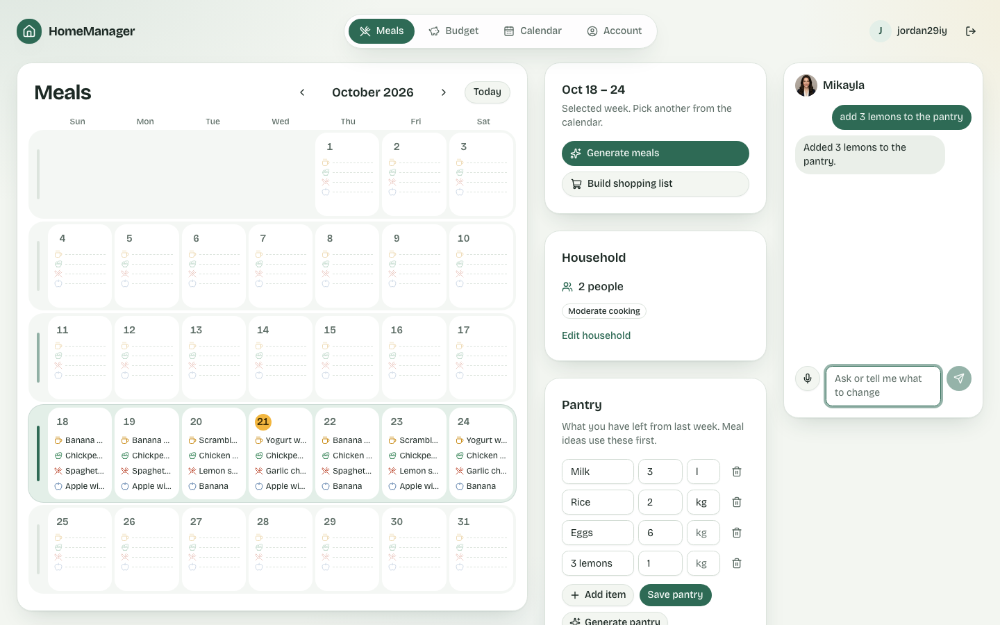
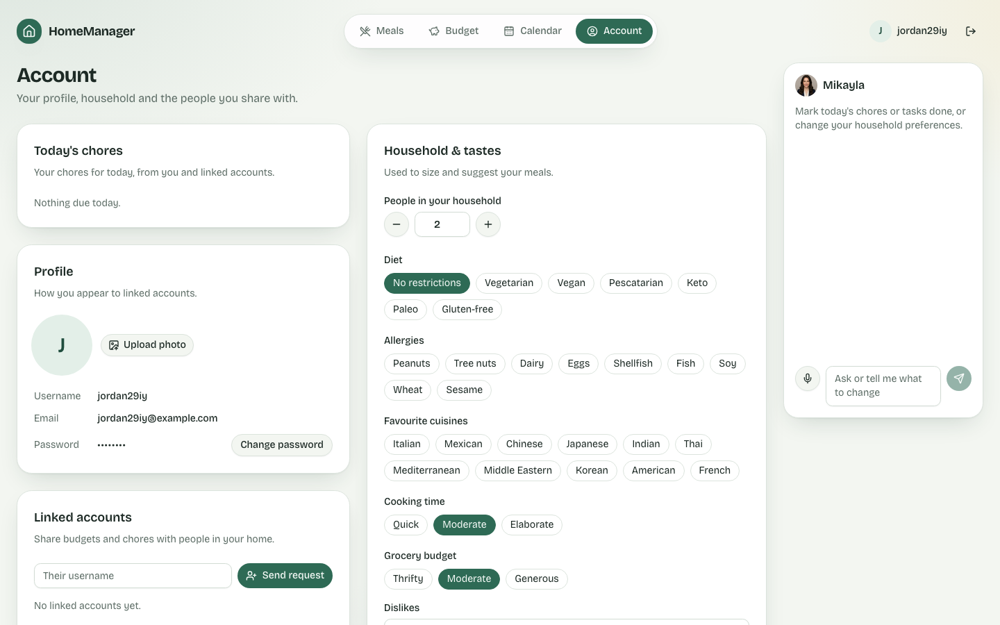
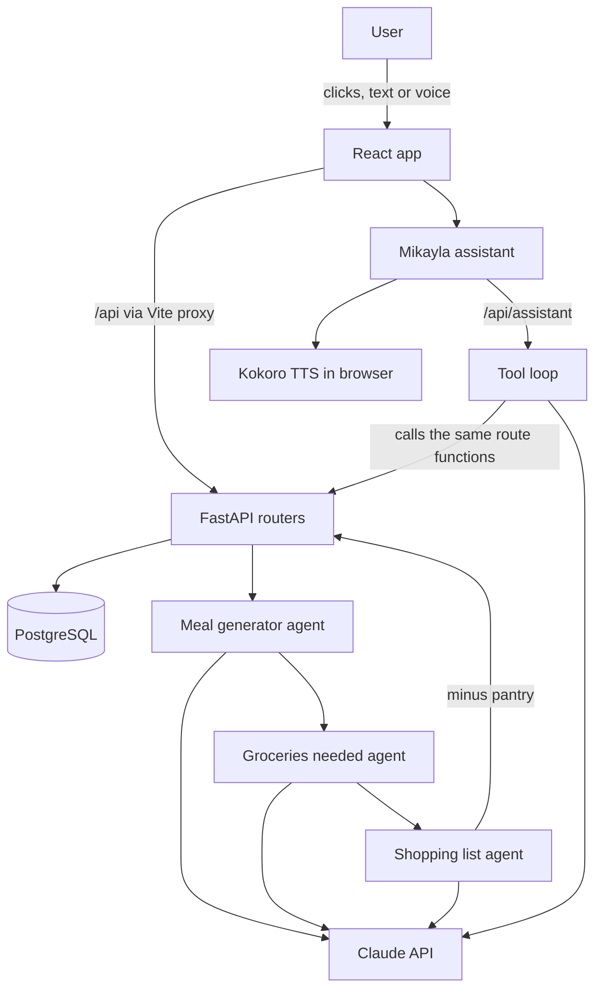

# HomeManager


-purple)


HomeManager is a private web app where a household plans its meals, runs its monthly budget, and keeps its calendar and chores, shared only with the people it chooses.
Three Claude agents handle the weekly meal and grocery work, and Mikayla, a voice assistant on every page, makes changes when asked.

---

## Table of Contents

- [Features](#features)
- [Demo](#demo)
- [Project Story](#project-story)
- [Results & Impact](#results--impact)
- [Tech Stack](#tech-stack)
- [Architecture](#architecture)
- [Getting Started](#getting-started)
- [Usage](#usage)
- [Testing](#testing)
- [Folder Structure](#folder-structure)
- [Author](#author)
- [Acknowledgments](#acknowledgments)

---

## Features

- **Meals**: A monthly meal calendar with breakfast, lunch, dinner and snack slots, plus a pantry and a weekly shopping list.
  - Three Claude agents work in a chain: a chef that generates meals, an ingredient planner that totals the groceries needed, and a list builder that subtracts the pantry and groups the rest by aisle.
  - Each member's allergies and diet are hard rules for every generated meal.
  - The shopping list remembers what you've checked off, and the pantry can rebuild itself from last week's pantry and purchases.
- **Budget**: A month-by-month view of income, expenses, savings, and what you own and owe.
  - Budgeted vs. actual for each line, with the money left over and net worth worked out for you.
  - Each line is marked "On track" or "Needs attention". "Copy last month" carries the plan forward.
  - A budget shared with a partner, with each line split by percentage.
- **Calendar & chores**: One monthly view of events, to-dos and repeating chores.
  - Chores repeat daily, weekly, every 2 weeks or monthly, on the weekdays you pick, and each has a named assignee.
  - Each day's chore is ticked off separately. Shared items can be marked done by any linked member.
- **Mikayla, the assistant**: A chat and voice helper on every page.
  - 17 actions across Meals, Budget, Calendar and Account. She can answer questions about what's on screen or make changes.
  - You talk to her through the mic. She answers aloud in a neural voice (Kokoro-82M) that runs entirely in the browser.
  - She asks before deleting or overwriting anything, and ignores instructions hidden in page text.
- **Private by default**: Nothing is shared until both people accept a link, and either person can unlink at any time.

---

## Demo


| Meals | Shopping list |
| :---: | :---: |
|  |  |
| **Budget** | **Calendar & chores** |
|  |  |
| **Mikayla** | **Account** |
|  |  |

---

## Project Story

Most home apps are about appliances, so people open them once a year when something breaks.
HomeManager is built for the things a household deals with every day: what's for dinner, what to buy, who takes out the recycling, and where the money went.
The goal was one shared place for all four, so a household no longer juggles spreadsheets, notes and group texts.
It has AI for the tedious parts (planning safe meals for everyone, totalling groceries, subtracting the pantry) and a voice assistant for when your hands are full.

---

## Results & Impact

- Brings meals, money, the schedule and chores into one app that a household uses every day.
- Planning a week's meals and shopping takes a few clicks. The pantry is subtracted automatically, which means less waste and fewer extra trips.
- Partners and housemates split shared costs by percentage and see who owns each chore. Each person's budget still shows their exact share.
- Built test-first: 300+ backend tests, ~150 frontend unit tests and 15 Playwright end-to-end scenarios (including two linked users). Every change went through 36 CI-gated pull requests.

---

## Tech Stack

**AI & Voice**:
- Anthropic Claude (`claude-sonnet-5-5`) with structured outputs
- Three meal-planning agents, and a tool-using page assistant (Mikayla)
- Kokoro-82M text-to-speech running in the browser on WebGPU
- The browser's built-in speech recognition for voice input

**Backend**:
- Python 3.14
- FastAPI
- Pydantic v2
- SQLAlchemy 2 + psycopg 3
- PostgreSQL
- argon2 password hashing, JWT in an httpOnly session cookie

**Frontend**:
- React + TypeScript (strict)
- Vite
- Tailwind CSS v4
- shadcn/ui (Radix)
- React Router

**Testing & Dev tools**:
- pytest, Vitest + Testing Library, Playwright
- GitHub Actions CI
- Claude Code
- Git & GitHub

---

## Architecture

**Flow**:
- The user signs in. A JWT in an httpOnly cookie authorizes every `/api` call, and users see only their own rows or rows shared through an accepted link.
- **Meals**: "Generate meals" sends the week, household size and preferences to the chef agent. The ingredient planner totals what those meals need, and the list builder subtracts the pantry and groups the rest by aisle.
- **Mikayla**: The page sends the chat along with its current context (month or week). Claude picks from that page's tools, which call the same route functions as the UI, so all permission checks live in one place.
- Replies are spoken by Kokoro, which runs in the browser, so no text-to-speech server is needed.

---

## Getting Started

Requires Python 3.14, Node 24+ and a local PostgreSQL.

1. Clone the repository
```bash
git clone https://github.com/cjr03/HomeManager.git
cd HomeManager
```
2. Create the databases
```bash
createdb homemanager && createdb homemanager_test && createdb homemanager_e2e
```
3. Install backend dependencies
```bash
python3.14 -m venv backend/.venv
backend/.venv/bin/pip install -r backend/requirements.txt
```
4. Add environment variables (defaults in comments):
```ini
ANTHROPIC_API_KEY=your_anthropic_api_key_here
JWT_SECRET=a_long_random_secret          # falls back to a dev secret; always set outside local dev
DATABASE_URL=postgresql+psycopg:///homemanager
COOKIE_SECURE=1                           # set when served over HTTPS
LLM_FAKE=1                                # optional: canned agent output, no API key needed
```
5. Run the backend
```bash
cd backend && .venv/bin/uvicorn app.main:app --reload
```
6. Backend is available at
```arduino
http://localhost:8000
```
7. Install and run the frontend
```bash
cd frontend
npm install && npx playwright install chromium
npm run dev
```
8. Frontend is available at (it proxies `/api` to the backend)
```arduino
http://localhost:5173
```

---

## Usage

- Start the backend and frontend.
- Open the frontend in a browser and create an account. Set your household size, diet, allergies and favorite cuisines.
- **Meals**: Pick a week, click **Generate meals**, then **Build shopping list**. Check items off at the store.
- **Budget**: Add income, expenses, savings, assets and loans, then use **Copy last month** to carry the plan forward.
- **Calendar**: Add events, tasks and repeating chores, and tick them off as they're done.
- **Account**: Link a partner or housemate by username to share budgets, chores and meal plans.
- Ask **Mikayla** anything by typing or tapping the mic, e.g. *"add 3 lemons to the pantry"*.

---

## Testing

```bash
cd backend && .venv/bin/pytest --cov=app   # unit + API integration
cd frontend && npm run lint && npm test     # typecheck + vitest
cd frontend && npm run build
cd frontend && npm run e2e                  # Playwright; starts both servers with LLM_FAKE=1
```

CI (`.github/workflows/ci.yml`) runs the `backend`, `frontend` and `e2e` jobs on every pull request and every push to `main`.

---

## Folder Structure

```plaintext
HomeManager/
├─ backend/
│  ├─ requirements.txt
│  ├─ app/
│  │  ├─ main.py          # app + router includes
│  │  ├─ db.py            # engine, sessions, Base
│  │  ├─ auth.py          # hashing, JWT cookie, /api/auth
│  │  ├─ accounts.py      # profiles + linked accounts
│  │  ├─ agents.py        # the three meal-planning Claude agents
│  │  ├─ assistant.py     # Mikayla: page assistant + tools
│  │  ├─ meals.py
│  │  ├─ budget.py
│  │  └─ calendar.py
│  └─ tests/              # pytest
├─ frontend/
│  ├─ src/
│  │  ├─ pages/           # Meals, Budget, Calendar, Account, Login
│  │  ├─ components/      # app shell, Mikayla panel, shadcn/ui
│  │  └─ lib/             # api client, voice, Kokoro worker
│  └─ e2e/                # Playwright specs
├─ docs/                  # README media
├─ .github/workflows/ci.yml
└─ README.md
```

---

## Author

**Cole Roberts**

*M.S. Artificial Intelligence, Santa Clara University*

Email: cole03roberts@gmail.com

LinkedIn: https://www.linkedin.com/in/cole03roberts/

---

## Acknowledgments

Anthropic Claude and the Claude API.
Kokoro-82M (via kokoro-js) for in-browser speech.
FastAPI, shadcn/ui and the open-source projects this is built on.
